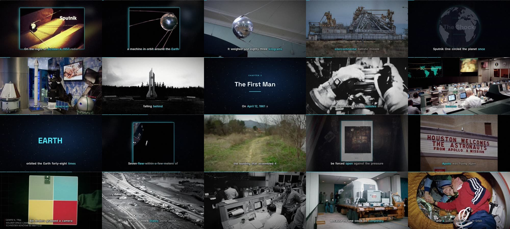
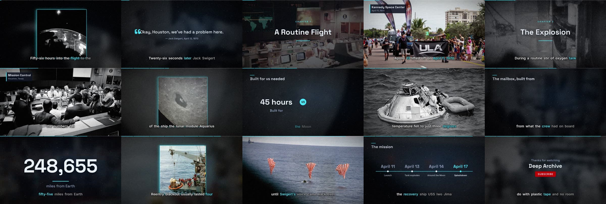

# Demo productions

## The Space Race (20-minute documentary)

`ytgen make --script examples/space_race.md --theme orbit --preset documentary --rate=-11%`

| | |
|---|---|
| Runtime | 19:37.75 at 1920×1080, 30 fps (H.264 + AAC), about 2.2 GB |
| QC | **pass**: A/V drift 0.051 s, −14.0 LUFS, −1.2 dBTP; no black or frozen frames, no decode errors ([report](demo-space-race-qc.json)) |
| Edit | 228 scenes in 11 chapters: HyperFrames title sequence, D3 globe flights, chapter cards, data graphics, kinetic type, word-synced captions |
| Media | 188 assets (168 public domain, 5 CC0, 6 CC BY, 9 CC BY-SA) from NASA, Wikimedia Commons and Internet Archive films ([credits](demo-space-race-CREDITS.md)); $0 AI spend |
| Render | 65 chapter-aligned chunks at about 28 fps on 4 cores. The fix pass re-rendered 25 chunks; 40 came from the cache |

## Apollo 13 (3-minute documentary)

`ytgen make --script examples/apollo13.md --theme orbit`

QC pass: 177.8 s, −14.0 LUFS, A/V drift 0.024 s.
